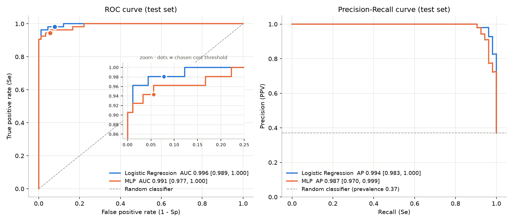
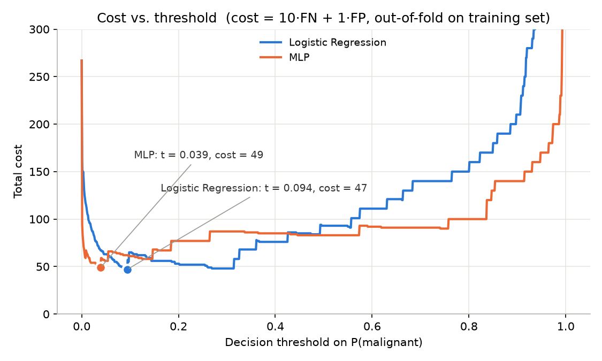

# ROC & PR Curves with Bootstrap CIs and Cost-Based Threshold — Breast Cancer Wisconsin

**Author:** GAITA MARIAN GABRIEL

ROC and Precision-Recall curves for a logistic regression and an MLP, with **bootstrap 95% confidence intervals for the AUC**. The decision threshold is chosen to minimise misclassification cost when a **false negative costs 10× a false positive**.

## Dataset

[Breast Cancer Wisconsin (Diagnostic)](https://archive.ics.uci.edu/dataset/17/breast+cancer+wisconsin+diagnostic), loaded from scikit-learn:

- 569 samples (212 malignant, 357 benign), 30 numeric cell-nucleus features
- **Positive class = malignant** (scikit-learn encodes it as 0, so labels are flipped)

## Method

1. **Split:** stratified train/test, 75% / 25% (`random_state=42`).
2. **Models:** same as the previous project, each in a pipeline with `StandardScaler`:
   - Logistic Regression (`max_iter=1000`)
   - MLP: hidden layers `(32, 16)`, ReLU, `alpha=1e-3`, `max_iter=2000`
3. **ROC & PR curves** on the test set. PR AUC is reported as Average Precision (AP).
4. **Bootstrap CI:** the test set is resampled with replacement 2000 times. The 2.5th and 97.5th percentiles of the AUC give the 95% CI.
5. **Threshold selection:**
   - Cost = 10·FN + 1·FP.
   - The threshold is chosen on **out-of-fold training predictions** (5-fold CV), never on the test set. The grid is 0 to 1 in steps of 0.001.
   - The chosen threshold is then applied once to the test set and compared with the default 0.5.
   - Reference: for perfectly calibrated probabilities, the Bayes-optimal threshold is C_FP / (C_FP + C_FN) = 1/11 ≈ 0.091.

## Results

### AUC with 95% bootstrap CI (test set, n = 143)

| Model | ROC AUC [95% CI] | PR AUC / AP [95% CI] |
|---|---|---|
| Logistic Regression | 0.996 [0.989, 1.000] | 0.994 [0.983, 1.000] |
| MLP | 0.991 [0.977, 1.000] | 0.987 [0.970, 0.999] |

### Default vs. cost-based threshold (test set)

| Model | Threshold | TP | FN | FP | TN | Se | Sp | Cost |
|---|---|---|---|---|---|---|---|---|
| Logistic Regression | 0.500 | 49 | 4 | 1 | 89 | 0.925 | 0.989 | 41 |
| Logistic Regression | **0.094** | 52 | 1 | 7 | 83 | **0.981** | 0.922 | **17** |
| MLP | 0.500 | 48 | 5 | 0 | 90 | 0.906 | 1.000 | 50 |
| MLP | **0.039** | 50 | 3 | 5 | 85 | **0.943** | 0.944 | **35** |

### Figures





### Interpretation

- Both models discriminate almost perfectly (ROC AUC ≥ 0.99). Their CIs overlap, so the difference between them is not significant.
- Because a missed cancer costs 10× more, the optimal threshold drops far below 0.5. The model flags a tumour as malignant even at ~4–9% predicted probability.
- For logistic regression the cost-based threshold cuts missed cancers from 4 to 1, at the price of 6 extra false alarms. Total cost falls from 41 to 17.
- Its chosen threshold (0.094) is very close to the theoretical 1/11 ≈ 0.091, a sign that its probabilities are well calibrated. The MLP's threshold is lower (0.039) because its probabilities are more extreme (overconfident).

## Project structure

```
.
├── bcw_roc_pr_threshold.py   # training, curves, bootstrap CIs, threshold
├── figures/                  # generated plots
│   ├── roc_pr_curves.png
│   └── cost_vs_threshold.png
├── run.sh                    # creates venv, installs deps, runs the script
├── README.md
└── .gitignore
```

## How to run

**With the script (Linux / macOS / Git Bash on Windows):**
```bash
chmod +x run.sh
./run.sh
```

**Manually:**
```bash
python -m venv .venv
source .venv/bin/activate        # Windows: .venv\Scripts\activate
pip install scikit-learn matplotlib
python bcw_roc_pr_threshold.py
```

**In PyCharm:** set the project interpreter to `.venv`, install `scikit-learn` and `matplotlib`, then right-click `bcw_roc_pr_threshold.py` → **Run**.

The figures are saved in `figures/`. A run takes ~15 s (cross-validation + bootstrap).

## Requirements

- Python 3.10+
- scikit-learn
- matplotlib

## Author

**GAITA MARIAN GABRIEL**
